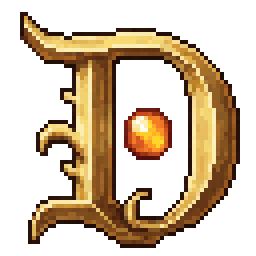
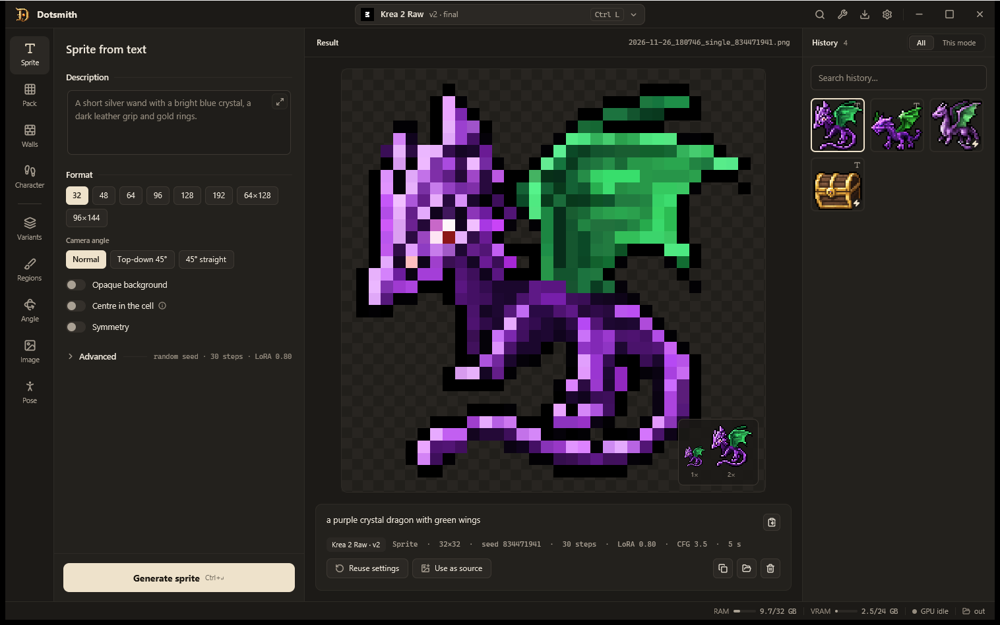

  

<h1 align="center">Dotsmith</h1>

  Sprites, packs, muros y personajes animados en pixel art, generados en tu propia GPU NVIDIA.

Por <a href="https://github.com/michyaraque">Michael Araque</a> · <a href="https://x.com/michyaraque">X</a> · <a href="README.md">Read in English</a>

Dotsmith es una aplicación de escritorio para crear pixel art listo para juegos. Describe un objeto y obtienes un PNG transparente del tamaño exacto que necesitas. También puedes partir de una imagen y redibujarla, repintar solo los píxeles que marques o convertir una foto en sprite. Todo se ejecuta en tu PC: sin cuenta, sin subir nada y sin coste por imagen.

## Funciones

| Modo | Qué genera |
| --- | --- |
| **Sprite** | Un objeto o prop del mapa a partir de texto, de 16 a 192 px, transparente u opaco. |
| **Pack** | Una hoja 2×2 o 3×3 de objetos relacionados en una sola pasada. |
| **Muros** | Un set de muros a juego (poste, norte, este, esquina) y, si quieres, la habitación 3×3 cerrada. |
| **Personaje** | Un ciclo de caminar de 8 frames en 1 o 4 direcciones, con reproductor y exportación a GIF. |
| **Variantes** | Nuevas versiones de un sprite: materiales, colores, formas. |
| **Ángulo** | El mismo objeto redibujado desde otra cámara, elegida con un gizmo 3D. |
| **Zonas** | Repinta solo los píxeles que marques; el resto queda idéntico. |
| **Imagen** | Una foto o ilustración convertida a pixel art, con IA o sin ella. |
| **Pose** | Un rig de silueta posable como punto de partida para Variantes. |

Modelos base, todos sobre el motor propio de Dotsmith en Rust + CUDA:

| Modelo | Destaca en |
| --- | --- |
| **Qwen-Image 2.1** (Base, Turbo) | Sprites detallados, packs y muros con un LoRA |
| **Krea 2** (Raw, Turbo) | Personajes y hojas de caminar con un LoRA |
| **LiliPixel V1** | Sprites nativos de 16, 32 y 64 px con transparencia real, en GPUs modestas |
| **RD Flow 64** | Sprites de 64 × 64 donde cada píxel es un color exacto de su paleta |

Además:

- **Píxeles exactos** a cualquier zoom, con vistas previas a 1× y 2×.
- **Vista previa en vivo**: los colores de la imagen aparecen mientras se genera y dan paso a la imagen real en cuanto toma forma. Puedes detenerla en cualquier paso.
- **Historial reproducible**: cada resultado es un PNG con un JSON de sus ajustes, y **Reutilizar ajustes** los recupera. Se puede buscar en él, y un borrado se deshace durante 15 segundos.
- **Gestor de modelos** con la ficha de Hugging Face de cada modelo y descargas de un clic, con reanudación y progreso. La carga muestra el porcentaje real y el tiempo restante.
- **Tus LoRAs**: copia archivos `.safetensors` en la carpeta de LoRAs; Dotsmith reconoce su modelo base y te deja ajustar su fuerza.
- **Paleta de comandos** (Ctrl + K) y navegación completa con teclado.
- **Tema oscuro y claro**, e interfaz en **español o inglés** según Windows.

## Requisitos

- Windows 10 u 11 de 64 bits
- NVIDIA RTX serie 30 o posterior con el controlador al día y al menos 6 GB de VRAM
- 16 GB de RAM; 32 GB para Qwen-Image 2.1 y Krea 2
- Espacio para los modelos que elijas (de 1,4 GB con LiliPixel a unos 18 GB con Krea 2)

Un modelo no tiene que caber en la VRAM. **Ajustes > GPU y memoria > Dónde van los pesos** los deja en la GPU cuando caben (**Auto**) y si no pasa las capas a la RAM: mismas imágenes, más lento. **RAM para el streaming** elige **Rápida** (las capas fijadas en RAM) o **Ahorro** (leídas de la caché de archivos de Windows, la menor RAM).

Picos medidos en una RTX 4090 con Turbo, 8 pasos y un lienzo de 512 px (VRAM / RAM / tiempo de generación):

| Modelo | En la GPU | En RAM, Rápida | En RAM, Ahorro |
| --- | --- | --- | --- |
| Qwen-Image 2.1 | 16,8 GB / 17,8 GB / 2,1 s | 2,5 GB / 16,6 GB / 7,0 s | 2,6 GB / 4,4 GB / 12,3 s |
| Krea 2 | 17,2 GB / 18,1 GB / 3,6 s | 2,4 GB / 19,1 GB / 9,5 s | 2,4 GB / 5,3 GB / 20,2 s |
| RD Flow 64 | 6,6 GB / 7,7 GB / 1,5 s | 2,3 GB / 8,2 GB / 1,6 s | 2,3 GB / 3,6 GB / 1,5 s |
| LiliPixel V1 | 2,7 GB / 3,4 GB / 2,2 s | siempre en la GPU | siempre en la GPU |

Los lienzos grandes necesitan más memoria de trabajo: Krea 2 a 1024 px llegó a 4,1 GB de VRAM en modo Ahorro. Ahorro va tan rápido como la caché de archivos, así que se ralentiza si Windows tiene menos RAM libre que el tamaño del modelo.

## Instalación

1. Descarga `Dotsmith-<versión>-setup.exe` (instalador) o `Dotsmith-<versión>-win64.zip` (portable).
2. Abre Dotsmith. La pantalla de inicio comprueba tu tarjeta gráfica y muestra todos los modelos base: pulsa **Descargar** en el que quieras, o **Elegir carpeta…** si ya tienes los archivos. Detalles en [docs/MODELS.md](docs/MODELS.md).
3. Pulsa **Empezar a crear**.

El runtime de CUDA viene incluido: no hace falta instalar el toolkit.

## Uso

Elige un modo a la izquierda (el grupo de arriba crea a partir de una descripción, el de abajo parte de una imagen), describe lo que quieres y pulsa **Ctrl + Intro**. El selector del centro de la barra superior cambia modelo base y LoRA.

| Tecla | Acción |
| --- | --- |
| Ctrl + Intro | Generar |
| Esc | Detener o cerrar una ventana |
| Ctrl + L | Elegir modelo y LoRA |
| Ctrl + K | Paleta de comandos |
| Ctrl + V | Pegar una imagen como origen |
| Ctrl + C | Copiar el resultado |
| ← / → | Resultado anterior / siguiente |
| Supr | Borrar el resultado (Ctrl + Z lo deshace durante 15 s) |
| Ctrl + , | Ajustes |

Los resultados se guardan en `Imágenes\Dotsmith`; puedes elegir otra carpeta en **Ajustes > General**.

## Problemas frecuentes

| Problema | Solución |
| --- | --- |
| "No hay una GPU compatible" | Actualiza el controlador de NVIDIA. Las GTX y anteriores no son compatibles. |
| Un modelo aparece como incompleto | **Ajustes > Modelos y LoRAs** muestra cada archivo y la carpeta donde lo busca Dotsmith. |
| La GPU se queda sin memoria | En **Ajustes > GPU y memoria**, pon **Dónde van los pesos** en **RAM** o activa el **Modo de poca VRAM**. También ayuda un tamaño menor o cerrar otras aplicaciones que usen la GPU. |
| Cualquier otro | **Ajustes > Acerca de > Registros > Abrir** y adjunta `dotsmith.log` al informe. |

## Autor

Dotsmith lo diseña y desarrolla **Michael Araque**. Sigue el proyecto en [GitHub](https://github.com/michyaraque) y [X](https://x.com/michyaraque).

## Compilar, contribuir y licencias

Mira [README.md](README.md#building-from-source) y [CONTRIBUTING.md](CONTRIBUTING.md). Dotsmith se publica bajo la [licencia MIT](LICENSE). Los modelos base y los LoRAs tienen sus propias licencias: revísalas antes de vender lo que generes.
