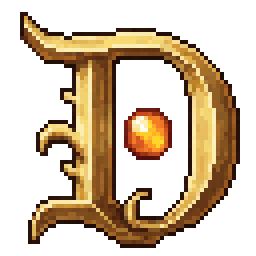
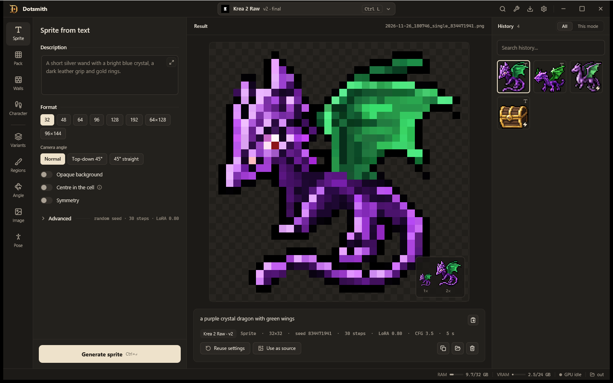
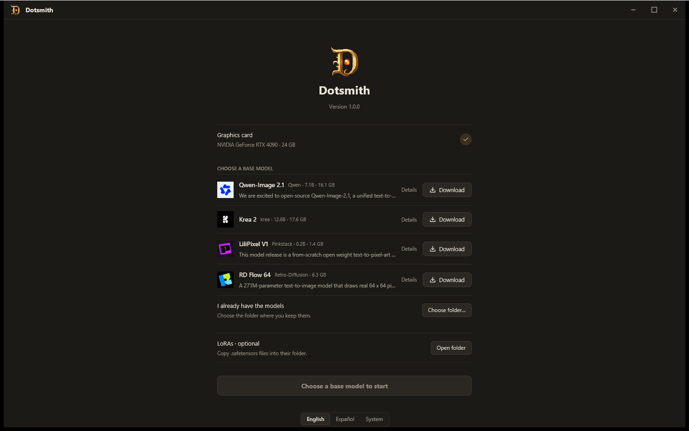
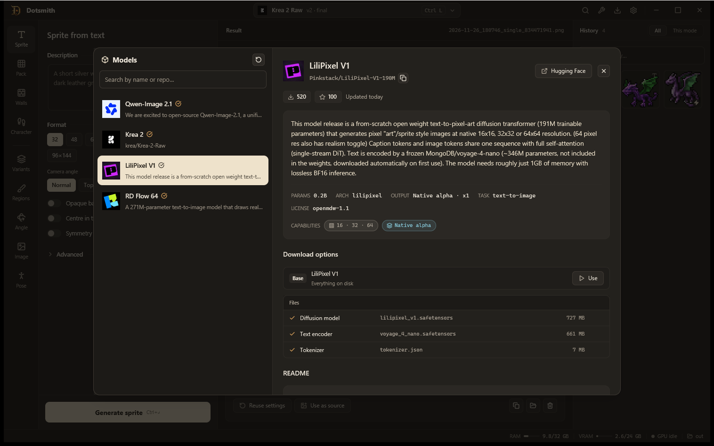

<p align="center">
  
</p>

<h1 align="center">Dotsmith</h1>

<p align="center">
  Pixel-art sprites, packs, walls and animated characters, generated on your own NVIDIA GPU.
</p>

<p align="center">
  
  
  
  
  <a href="LICENSE"></a>
</p>

<p align="center">By <a href="https://github.com/michyaraque">Michael Araque</a> · <a href="https://x.com/michyaraque">X</a> · <a href="README.es.md">Leer en español</a></p>



Dotsmith is a desktop app for making game-ready pixel art. Describe an object and get a transparent PNG at the exact size you need. You can also start from an image and redraw it, repaint only the pixels you mark, or turn a photo into a sprite. Everything runs on your machine: no account, no upload, no per-image cost.

## Features

| Mode | What it makes |
| --- | --- |
| **Sprite** | One item or map prop from text, 16 to 192 px, transparent or opaque. |
| **Pack** | A 2×2 or 3×3 sheet of related items in one pass. |
| **Walls** | A matching wall set (pile, north, east, corner), and optionally the closed 3×3 room. |
| **Character** | An 8-frame walk cycle in 1 or 4 directions, with a live player and GIF export. |
| **Variants** | New versions of an existing sprite: materials, colours, shapes. |
| **Angle** | The same object redrawn from another camera angle, set with a 3D gizmo. |
| **Regions** | Repaint only the pixels you paint; everything else stays identical. |
| **Image** | A photo or illustration converted to pixel art, with or without AI. |
| **Pose** | A posable silhouette rig to use as a starting point for Variants. |

Base models, all running on Dotsmith's own Rust + CUDA engine:

| Model | Best at |
| --- | --- |
| **Qwen-Image 2.1** (Base, Turbo) | Detailed sprites, packs and walls with a LoRA |
| **Krea 2** (Raw, Turbo) | Characters and walk sheets with a LoRA |
| **LiliPixel V1** | Native 16, 32 and 64 px sprites with real alpha, on modest GPUs |
| **RD Flow 64** | 64 × 64 sprites where every pixel is an exact palette colour |

You also get:

- **Exact pixels.** Every sprite pixel is a sharp square at any zoom, with 1× and 2× previews.
- **Live preview.** The image's colours drift in while it denoises and give way to the real picture as it takes shape. Stop at any step.
- **Reproducible history.** Every result is a PNG plus a JSON of its settings. **Reuse settings** brings them back in one click. History is searchable, and a deleted result can be undone for 15 seconds.
- **Model manager.** Every model with its live Hugging Face card, and one-click downloads with resume and progress. Loading shows the real percentage and the time left.
- **Your own LoRAs.** Drop `.safetensors` files into the LoRA folder; Dotsmith recognises their base model from the file and lets you set their strength.
- **Command palette** (Ctrl + K) for every mode, setting, tool and folder, and full keyboard navigation.
- **Dark and light themes**, and an **English or Spanish** interface that follows Windows by default.

## Requirements

- Windows 10 or 11, 64-bit
- NVIDIA RTX 30 series or newer with a current driver and at least 6 GB of VRAM
- 16 GB of RAM; 32 GB for Qwen-Image 2.1 and Krea 2
- Disk space for the models you pick (1.4 GB for LiliPixel up to about 18 GB for Krea 2)

A model doesn't have to fit in VRAM. **Settings > GPU & memory > Where weights live** keeps the weights on the GPU when they fit (**Auto**) and otherwise moves the layers to RAM: same images, slower. **Streaming RAM** picks **Fast** (the layers locked in RAM) or **Saver** (read from the Windows file cache, least RAM).

Peaks measured on an RTX 4090 with Turbo, 8 steps and a 512 px canvas (VRAM / RAM / generation time):

| Model | On the GPU | In RAM, Fast | In RAM, Saver |
| --- | --- | --- | --- |
| Qwen-Image 2.1 | 16.8 GB / 17.8 GB / 2.1 s | 2.5 GB / 16.6 GB / 7.0 s | 2.6 GB / 4.4 GB / 12.3 s |
| Krea 2 | 17.2 GB / 18.1 GB / 3.6 s | 2.4 GB / 19.1 GB / 9.5 s | 2.4 GB / 5.3 GB / 20.2 s |
| RD Flow 64 | 6.6 GB / 7.7 GB / 1.5 s | 2.3 GB / 8.2 GB / 1.6 s | 2.3 GB / 3.6 GB / 1.5 s |
| LiliPixel V1 | 2.7 GB / 3.4 GB / 2.2 s | always on the GPU | always on the GPU |

Bigger canvases need more working memory: Krea 2 at 1024 px peaked at 4.1 GB of VRAM in Saver mode. Saver is only as fast as the file cache, so it slows down when Windows has less free RAM than the model's size.

## Install

1. Download `Dotsmith-<version>-setup.exe` (installer) or `Dotsmith-<version>-win64.zip` (portable) from Releases.
2. Start Dotsmith. The start screen checks your graphics card and lists every base model: click **Download** on the one you want, or **Choose folder…** if you already have the files. See [docs/MODELS.md](docs/MODELS.md).
3. Click **Start creating**.

The CUDA runtime ships with Dotsmith, so you don't need to install the CUDA toolkit.



## Usage

Pick a mode on the left (the top group makes things from a description, the bottom group starts from an image), describe what you want and press **Ctrl + Enter**. The selector in the middle of the title bar switches base model and LoRA.



| Key | Action |
| --- | --- |
| Ctrl + Enter | Generate |
| Esc | Stop, or close a dialog |
| Ctrl + L | Choose model and LoRA |
| Ctrl + K | Command palette |
| Ctrl + V | Paste an image as the source |
| Ctrl + C | Copy the result |
| ← / → | Previous / next result |
| Delete | Delete the result (Ctrl + Z undoes it for 15 s) |
| Ctrl + , | Settings |

Results are saved to `Pictures\Dotsmith`. You can choose another folder in **Settings > General**.

## Troubleshooting

| Problem | Fix |
| --- | --- |
| "No compatible GPU" | Update the NVIDIA driver. GTX and older cards aren't supported. |
| A model shows as missing | **Settings > Models & LoRAs** lists every file and the folder Dotsmith looks in. |
| The GPU ran out of memory | In **Settings > GPU & memory**, set **Where weights live** to **RAM** or turn on **Low-VRAM mode**. A smaller size or closing other apps that use the GPU also helps. |
| Anything else | **Settings > About > Logs > Open** and attach `dotsmith.log` to a bug report. |

## Building from source

### Prerequisites

- Rust: `rustup` installs the pinned toolchain from `rust-toolchain.toml` on the first build
- CUDA Toolkit 13.1
- Visual Studio 2022 Build Tools (MSVC) and the Windows 10 SDK

The build needs two tool paths that depend on your machine. Put them in `%USERPROFILE%\.cargo\config.toml`, adjusting the versions to yours:

```toml
[env]
NVCC_CCBIN = 'C:\Program Files (x86)\Microsoft Visual Studio\2022\BuildTools\VC\Tools\MSVC\14.44.35207\bin\Hostx64\x64\cl.exe'
GPUI_FXC_PATH = 'C:\Program Files (x86)\Windows Kits\10\bin\10.0.19041.0\x64\fxc.exe'
```

### Run

```powershell
cargo run --release -p dotsmith
```

### Check a change

```powershell
cargo fmt --all --check
cargo clippy --workspace --all-targets --release -- -D warnings
cargo test --workspace --release
cargo test --workspace --release -- --ignored    # end to end on this machine's GPU and network
```

### Release builds

```powershell
.\gpui\scripts\package.ps1
```

| Output | Path |
| --- | --- |
| Portable folder | `dist/Dotsmith/` |
| Portable zip | `dist/Dotsmith-<version>-win64.zip` |
| Installer | `dist/Dotsmith-<version>-setup.exe` |

## Further reading

- [docs/ARCHITECTURE.md](docs/ARCHITECTURE.md): how the app, the engine and the model families fit together
- [docs/MODELS.md](docs/MODELS.md): base model files, the catalog, LoRA libraries and `version.json`
- [docs/RELEASING.md](docs/RELEASING.md): versioning, packaging and publishing a release
- [CONTRIBUTING.md](CONTRIBUTING.md) · [SECURITY.md](SECURITY.md) · [CHANGELOG.md](CHANGELOG.md)

## Credits

- Interface: [GPUI](https://github.com/zed-industries/zed) (Apache 2.0)
- Tensor runtime: [candle](https://github.com/huggingface/candle) (MIT / Apache 2.0)
- Icons: [Lucide](https://lucide.dev) (ISC)
- Base models: Qwen-Image 2.1 (Alibaba · Qwen), Krea 2 (Krea), LiliPixel V1 (Pinkstack) with voyage-4-nano (MongoDB), RD Flow 64 (Retro Diffusion)

## Author

Dotsmith is designed and built by **Michael Araque**. Follow the project on [GitHub](https://github.com/michyaraque) and [X](https://x.com/michyaraque).

## Legal

Dotsmith is released under the [MIT License](LICENSE).

Dotsmith doesn't include any model weights. The base models and LoRAs you use with it have their own licenses. Check each provider's terms before you sell or publish what you make with them. The CUDA runtime libraries are redistributed under the NVIDIA CUDA EULA (`licenses/NVIDIA-CUDA-EULA.txt` in every release).
